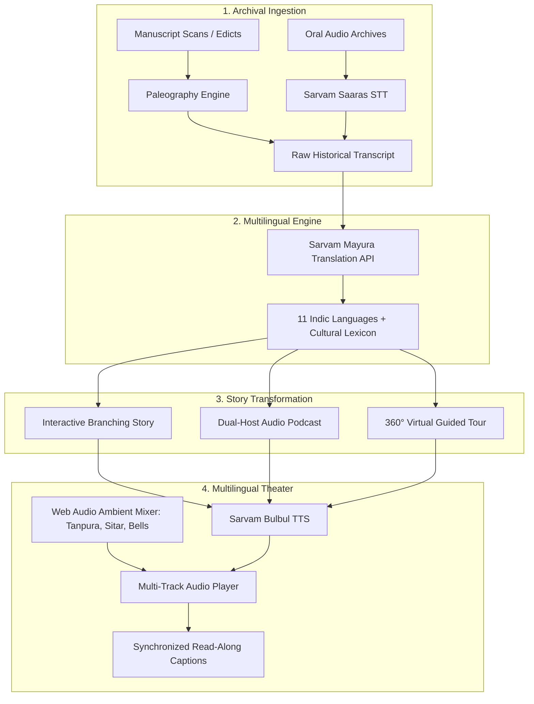

# 🏛️ HeritageVerse: Multilingual AI Heritage Storytelling Agent

> **Bringing Historical Inscriptions, Manuscripts & Oral Archives to Life with Sarvam AI**  
> **Developed by:** **Debonmoy Sanyal** • *Jadavpur University*  
> **Repository:** [https://github.com/Debonmoy-coder/project-1](https://github.com/Debonmoy-coder/project-1)

[](https://www.python.org/)
[](https://fastapi.tiangolo.com/)
[](https://sarvam.ai)
[](LICENSE)

---

## 🌟 Overview

**HeritageVerse** is an end-to-end intelligent agent system designed to preserve, decipher, and revitalize India's cultural heritage. It bridges ancient epigraphs and oral folklore with contemporary digital experiences by transforming raw historical artifacts into:

1. **Interactive Branching Stories** (Choose-Your-Own-Adventure chapters)
2. **Immersive Audio Podcasts & Docudramas** (2-host audio scripts with sound cues)
3. **360° Guided Virtual Walking Tours** (Step-by-step spatial exploration)
4. **Multilingual Voice Narrations** (Natural Indic speech with synchronized ambient soundscapes)

---

## 🚀 Key Features

### 1. Inscription Paleography & Oral Archive Ingestion
- **Historic Manuscripts**: Ingests high-resolution scans of stone edicts, palm-leaf manuscripts (*Talapatra*), and copper plates. Features paleographical classification across **Brahmi**, **Modi**, **Grantha**, **Devanagari**, **Kaithi**, and **Old Bengali** scripts.
- **Oral Archives (Sarvam Saaras STT)**: Real-time browser audio recording and file upload to transcribe folk ballads, elder testimonies, and oral histories.

### 2. Multilingual Translation & Cultural Lexicon (Sarvam Mayura)
- Seamless translation across **11 Indic languages**:
  - Hindi (`hi-IN`), Bengali (`bn-IN`), Tamil (`ta-IN`), Telugu (`te-IN`), Marathi (`mr-IN`), Gujarati (`gu-IN`), Kannada (`kn-IN`), Malayalam (`ml-IN`), Punjabi (`pa-IN`), Odia (`od-IN`), and English (`en-IN`).
- **Archaic Cultural Lexicon**: Automatically extracts and contextualizes archaic historical terms (e.g. *Devanampriya*, *Farman*, *Kalvettu*, *Moner Manush*, *Swabhiman*).

### 3. Story Workshop & Narrative Synthesis
- **Interactive Story Mode**: Step into the shoes of historical figures (court scribes, cavalry officers, bronze casters) with dynamic decision trees.
- **Heritage Podcast Mode**: Dual-speaker audio dramas featuring *The Chronicler* and *The Explorer*, complete with environmental sound cues.
- **Virtual Guided Tour Mode**: Spatial audio walk across historic monuments with waypoints, architectural secrets, and audio hooks.

### 4. Multilingual Voice & Ambient Soundscape Theater (Sarvam Bulbul TTS)
- Powered by **Sarvam Bulbul TTS** with natural Indian speaker voices (`shubh`, `ratan`, `kavitha`, `priya`, `arvind`, `aditya`, `roopa`, `shreya`).
- **Harmonic Ambient Soundscapes**: Real-time Web Audio API synthesizer mixing:
  - 🔔 *Sacred Temple Bells & Tanpura* (432Hz harmonic drone)
  - 👑 *Maratha Darbar & Sitar Chords*
  - 🌧️ *Monsoon Rain on Palm Leaves*
  - 🧭 *Desert Caravan & Night Wind*
  - 🔥 *Distant War Drums & Campfire*
- **Synchronized Read-Along Captions**: Real-time karaoke-style sentence illumination.

### 5. Curated Heritage Vault
Includes 5 pre-loaded historical treasures:
1. **Major Rock Edict of Emperor Ashoka** (Girnar, Gujarat • c. 257 BCE • Brahmi Script)
2. **Royal Farman of Chhatrapati Shivaji Maharaj** (Raigad, Maharashtra • c. 1674 CE • Modi Script)
3. **Temple Dedication of Rajaraja Chola I** (Thanjavur, Tamil Nadu • c. 1010 CE • Tamil-Grantha Script)
4. **Oral Archive: Mystic Ballads of Lalon Fakir** (Kushtia/Bengal • c. 19th Century • Oral Lore)
5. **Letter of Defiance: Rani Lakshmibai of Jhansi** (Bundelkhand • c. 1857 CE • Hindustani)

---

## 🏗️ Architecture



---

## ⚡ Quickstart Guide

### 1. Prerequisites
- Python 3.10 or higher
- Sarvam AI API subscription key (from [dashboard.sarvam.ai](https://dashboard.sarvam.ai))

### 2. Installation
```bash
# Clone or navigate to the project directory
cd project

# Install dependencies
pip install -r requirements.txt
```

### 3. Configure API Key
Create a `.env` file (or copy from `.env.example`):
```env
SARVAM_API_KEY=your_sarvam_api_key_here
PORT=8000
HOST=127.0.0.1
```
*(Note: You can also update and verify your API key dynamically from the UI's Settings Modal!)*

### 4. Run the Application
```bash
python main.py
```
Open your browser and navigate to:
```
http://127.0.0.1:8000
```

---

## 📡 REST API Reference

| Endpoint | Method | Description |
|---|---|---|
| `/api/status` | `GET` | Health check, API key verification, voice and language catalogs |
| `/api/settings/key` | `POST` | Update in-memory Sarvam API key |
| `/api/vault` | `GET` | List all curated archives in the Heritage Vault |
| `/api/vault/{id}` | `GET` | Retrieve detailed archive data, scripts, and pre-built stories |
| `/api/transcribe/manuscript` | `POST` | Upload manuscript image or text for paleography transcription |
| `/api/transcribe/audio` | `POST` | Upload audio for Sarvam Saaras Speech-to-Text |
| `/api/translate` | `POST` | Translate text using Sarvam Mayura API (11 Indic languages) |
| `/api/story/transform` | `POST` | Transform text into Interactive Story, Podcast, or Tour |
| `/api/narration/generate` | `POST` | Generate voice narration via Sarvam Bulbul TTS + soundscapes |
| `/api/chat` | `POST` | Interactive Q&A with the Heritage Chronicler persona |

---

## 🛡️ Robust Resilience & Demo Fallback Mode
If your Sarvam AI API key has 0 credits or quota exhausted (`HTTP 402`), the application **never crashes**. It automatically activates the **High-Fidelity Heritage Engine** with browser Indic speech synthesis and harmonic ambient chords, allowing for uninterrupted classroom, hackathon, and conference demonstrations!

---

## 📜 License
Distributed under the MIT License. Built for cultural heritage preservation and digital storytelling.
